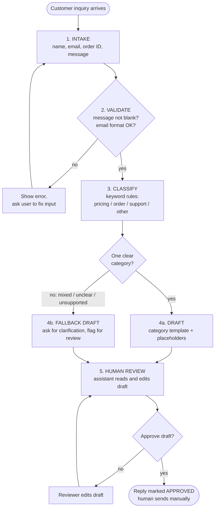

# SmartInquiry Workflow (Mermaid source)

GitHub renders the diagram below automatically. A standalone image is in `flowchart.svg`.

## Step notes

| Step | What happens | Output |
|------|--------------|--------|
| 1. Intake | Support assistant enters the inquiry in a form | Structured record (name, email, order ID, message, timestamp) |
| 2. Validate | Reject blank messages and malformed emails | Valid record or an error message |
| 3. Classify | Keyword rules with priority and fallback (built Day 2) | `pricing`, `order`, `support` or `other` |
| 4. Draft | Category template, or a clarification fallback (built Day 3) | Editable draft text |
| 5. Human review | Explicit approve step before anything is final (built Day 4) | Approved or revised reply |

**Key rule:** if a message mixes categories (for example pricing and a complaint) it is marked `other` and sent to human review rather than guessed.
